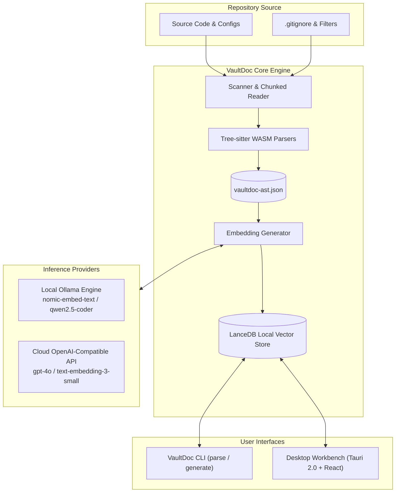

<p align="center">
  
</p>

<h1 align="center">VaultDoc</h1>

<p align="center">
  <strong>Local-First Codebase Intelligence, AST-Guided Vector RAG & Developer Workbench</strong>
</p>

<p align="center">
  <a href="#key-features"></a>
  <a href="#desktop-studios"></a>
  <a href="#cli-usage"></a>
  <a href="#vector-database"></a>
  <a href="#llm-providers"></a>
  <a href="LICENSE"></a>
</p>

---

## 📖 Overview

**VaultDoc** is an offline-capable, AST-aware codebase intelligence platform and desktop workbench. It indexes entire software repositories down to individual functions, classes, types, and schemas using WebAssembly-powered Tree-sitter parsers, embeds them into a zero-config local vector database (**LanceDB**), and delivers grounded generative documentation, architectural maps, test suites, and technical specs.

Whether you want complete privacy running entirely offline via **Ollama**, or extreme throughput via high-performance cloud LLMs (OpenAI, Anthropic, OpenRouter), VaultDoc operates with full transparency—linking every response and citation directly back to exact source lines and vector distance scores.

---

## 🚀 Key Features

- **🌳 AST-Level Multi-Language Parsing**: Uses `web-tree-sitter` and compiled WebAssembly grammars to inspect semantic code structures rather than raw text slices.
- **⚡ Memory-Optimized Streaming Reader**: Chunks file reading via fixed 8KB buffers so even massive codebases can be indexed without hitting Node.js heap limits.
- **💾 Embedded Vector Storage (LanceDB)**: Zero external server dependencies. Vectors and metadata are saved and queried locally inside `.doc-cache/lancedb`.
- **🔒 Local-First or Cloud Inference**:
  - **Local-First**: Integrated Ollama pipeline (`nomic-embed-text` + `qwen2.5-coder:7b` or custom models) with automatic managed sidecar health detection.
  - **Cloud BYOK**: OpenAI-compatible endpoint support (`text-embedding-3-small`, `gpt-4o`, custom base URLs, Groq, OpenRouter).
- **🖥️ High-Performance Desktop Workbench**: A frameless, dark-mode desktop app crafted with **Tauri 2.0**, **React 18**, **TypeScript**, and **TailwindCSS**.
- **🔍 Transparent RAG Inspector**: Real-time visualization of retrieved code chunks, cosine similarity distances, and token contexts backing every AI-generated output.
- **🛠️ Dual Workflow (CLI & GUI)**: Use the terminal command-line interface for CI/CD automation or launch the desktop app for interactive exploration.

---

## 🏛️ System Architecture



---

## 🎨 Desktop Workbench Studios

The VaultDoc desktop app includes dedicated studios accessible via the Activity Dock:

| Studio | Icon | Purpose |
| :--- | :---: | :--- |
| **Chat Studio** | 💬 | Central command center for natural-language codebase questions, guided refactoring, and code explanation with line-level citations and persistent sessions. |
| **Architecture Studio** | 📐 | Interactive system-level diagrams, component hierarchies, data-flow pipelines, and Mermaid diagrams synthesized directly from AST definitions. |
| **Docs Studio** | 📝 | Split-pane live Markdown documentation workspace with auto-generated module documentation, API references, and architecture guides. |
| **Ticket & Spec Studio** | 📋 | Converts user stories and feature requests into detailed technical specifications, acceptance criteria, edge-case matrices, and implementation plans. |
| **Pre-PR Audit Studio** | 🛡️ | Automated pre-pull-request code review detecting anti-patterns, security risks, performance regressions, and architectural drift categorized by severity. |
| **Test Suite Studio** | 🧪 | Generates targeted unit tests, integration cases, boundary assertions, and mock scaffolding directly mapped to discovered functions and classes. |
| **Git & PR Studio** | 🔀 | Staged/unstaged diff inspection, automated conventional commit message drafting, and pull-request summary generation. |
| **RAG Inspector** | 🔍 | Ground-truth inspector displaying retrieved vector chunks, symbol types, file locations, and cosine distance scores. |

---

## 🌐 Supported Languages & Formats

VaultDoc supports semantic parsing across **20+ languages and formats** via Tree-sitter WASM grammars:

- **Web & Full-Stack**: TypeScript (`.ts`, `.tsx`), JavaScript (`.js`, `.jsx`, `.mjs`, `.cjs`)
- **Backend & Systems**: Python (`.py`), Go (`.go`), Rust (`.rs`), Java (`.java`), C (`.c`, `.h`), C++ (`.cpp`, `.hpp`, `.cc`), C# (`.cs`)
- **Mobile & Scripting**: Swift (`.swift`), Kotlin (`.kt`), Ruby (`.rb`), PHP (`.php`), Bash/Shell (`.sh`, `.bash`)
- **Data & Configuration**: SQL (`.sql`), JSON (`.json`), YAML (`.yaml`, `.yml`), TOML (`.toml`), XML (`.xml`), HTML/CSS (`.html`, `.css`, `.scss`)
- **Documentation**: Markdown (`.md`, `.mdx`), Plain Text (`.txt`), CSV (`.csv`)

---

## 📦 Project Structure

```text
vaultdoc/
├── desktop/                  # Tauri 2.0 Desktop Workbench
│   ├── src/                  # React 18 + TypeScript + TailwindCSS frontend
│   │   ├── components/       # Chat, Architecture, PrePR, Spec, Test, and Editor Studios
│   │   ├── services/         # AI providers, LanceDB bridge, Git, theme, and sidecar client
│   │   └── App.tsx           # Main desktop workbench controller
│   └── src-tauri/            # Rust backend (window controls, sidecar process management)
├── src/                      # VaultDoc CLI & Core Engine
│   ├── providers/            # Base, Ollama, and Cloud (OpenAI-compatible) LLM providers
│   ├── services/             # LanceDB generator & vector search pipeline
│   ├── index.ts              # Commander CLI entrypoint
│   ├── parser.ts             # Web-Tree-sitter AST extraction & chunked reader
│   ├── scanner.ts            # Gitignore-aware recursive file scanner
│   └── types.ts              # Core AST and Symbol type definitions
├── resources/                # Tree-sitter WASM grammars and sidecar binaries
├── package.json              # Root workspace manifest & CLI bin entrypoint
└── tsconfig.json             # Root TypeScript configuration
```

---

## ⚡ Quick Start

### Prerequisites

- **Node.js**: `v18.0.0` or higher
- **npm** or **pnpm**
- *(Optional for Desktop App)*: [Rust & Cargo](https://doc.rust-lang.org/cargo/getting-started/installation.html) (for building Tauri)
- *(Optional for Local LLM)*: [Ollama](https://ollama.com/) running locally:
  ```bash
  ollama pull nomic-embed-text
  ollama pull qwen2.5-coder:7b
  ```

---

### Installation

1. Clone the repository:
   ```bash
   git clone https://github.com/your-username/vaultdoc.git
   cd vaultdoc
   ```

2. Install root dependencies and build the TypeScript CLI:
   ```bash
   npm install
   npm run build
   ```

3. Install desktop dependencies:
   ```bash
   cd desktop
   npm install
   cd ..
   ```

---

## 💻 CLI Usage

The VaultDoc CLI can be invoked globally or through `npx` / `node dist/index.js`.

### 1. Parse a Repository into AST Symbols

Scan any codebase and extract semantic symbols into a structured JSON AST file:

```bash
# Parse current directory
node ./dist/index.js parse

# Parse a specific folder with custom output
node ./dist/index.js parse ./path/to/project -o ./my-ast.json
```

### 2. Generate Documentation via RAG

Embed the AST into LanceDB and stream generated documentation to markdown:

#### Using Local Ollama (Default)
```bash
node ./dist/index.js generate "Generate a comprehensive system architecture overview" \
  --provider ollama \
  -i vaultdoc-ast.json \
  -o ARCHITECTURE.md
```

#### Using Cloud LLM (OpenAI / OpenRouter / Compatible)
```bash
node ./dist/index.js generate "Document the authentication and data flow" \
  --provider cloud \
  --api-key sk-your-api-key \
  --base-url https://api.openai.com/v1 \
  -i vaultdoc-ast.json \
  -o SECURITY.md
```

---

## 🖥️ Running the Desktop Workbench

### Development Mode

Run the frontend with Vite and launch the Tauri window:

```bash
npm run tauri dev
```

*(Alternatively, run just the React web UI in browser: `cd desktop && npm run dev`)*

### Production Build

Package the application into an OS installer (Windows `.msi`/`.exe`, macOS `.dmg`, Linux `.AppImage`/`.deb`):

```bash
npm run tauri:build
```

Installers will be generated in `desktop/src-tauri/target/release/bundle/`.

---

## ⚙️ Configuration & Environment Variables

| Variable | Default | Description |
| :--- | :--- | :--- |
| `OPENAI_API_KEY` | *None* | API Key for OpenAI or any compatible cloud provider. |
| `OPENAI_BASE_URL` | `https://api.openai.com/v1` | Custom endpoint for cloud inference (e.g. Groq, LocalAI, vLLM). |
| `VAULTDOC_WASM_DIR` | Auto-detected | Custom path to Tree-sitter `.wasm` grammar files. |
| `VAULTDOC_OLLAMA_PATH` | Auto-detected | Absolute path to bundled or standalone Ollama executable. |

---

## 🔒 Security & Privacy

- **Air-Gapped Operation**: With the Ollama provider enabled, no code snippets, file names, or queries leave your machine.
- **Embedded Database**: LanceDB runs in-process with zero network footprint.
- **Selective Scans**: Honors `.gitignore`, file-size cutoffs (1MB limit per file), and skips sensitive or binary blobs automatically.

---

## 🤝 Contributing

Contributions, feature requests, and issue reports are welcome!

1. Fork the repository
2. Create your feature branch (`git checkout -b feature/amazing-feature`)
3. Commit your changes (`git commit -m 'feat: add amazing feature'`)
4. Push to the branch (`git push origin feature/amazing-feature`)
5. Open a Pull Request

---

## 📄 License

This project is licensed under the **ISC License**. See the [LICENSE](LICENSE) file for details.
